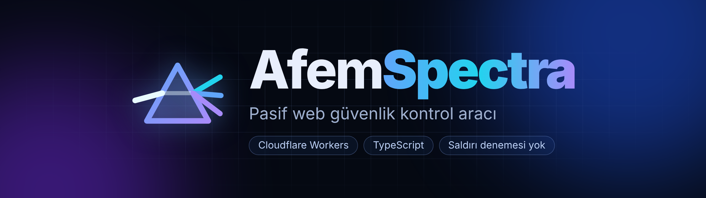
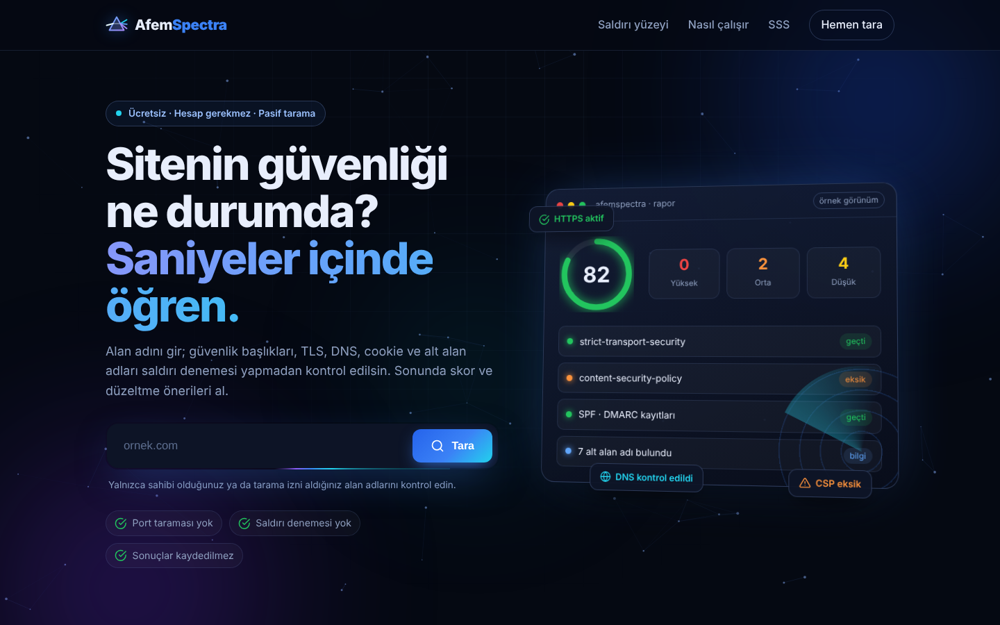
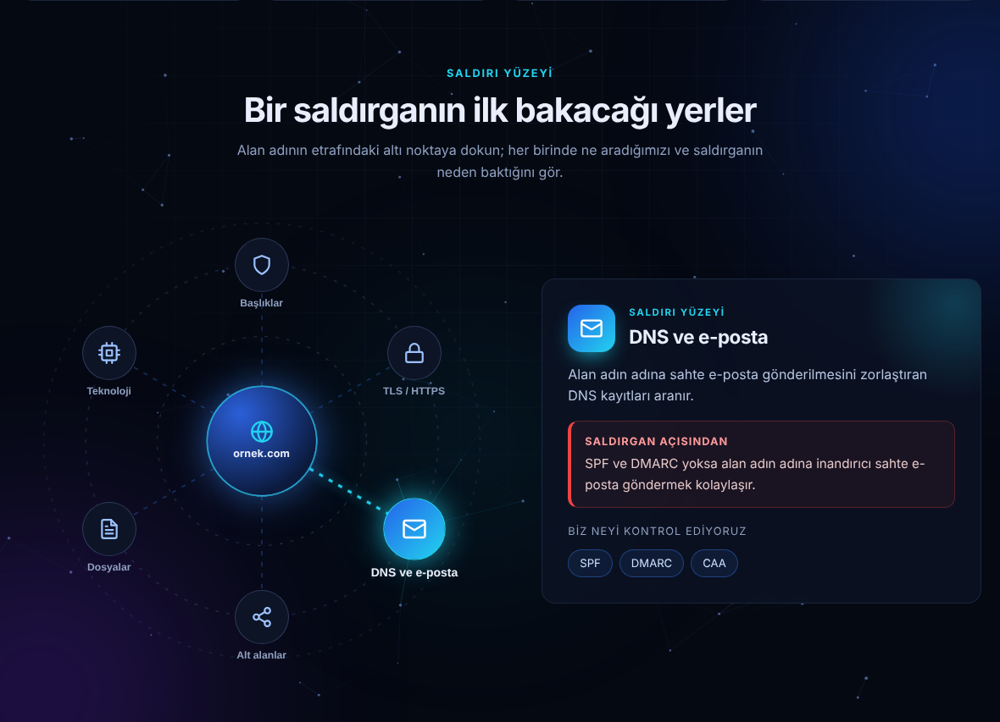
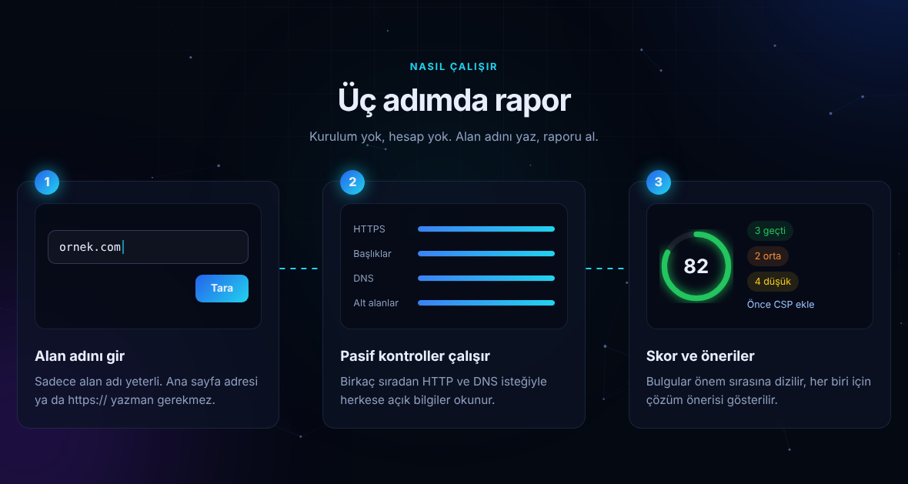
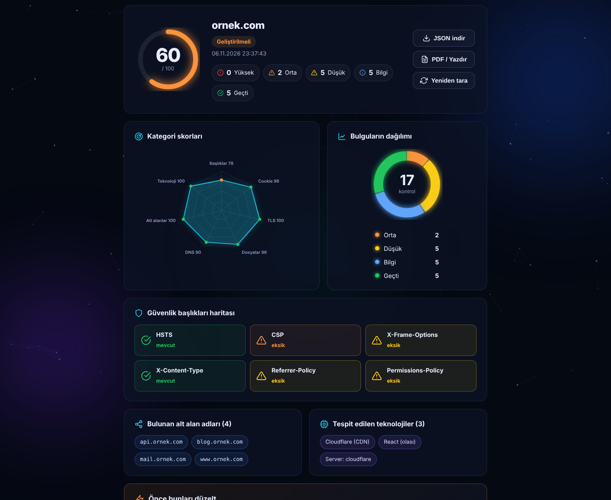
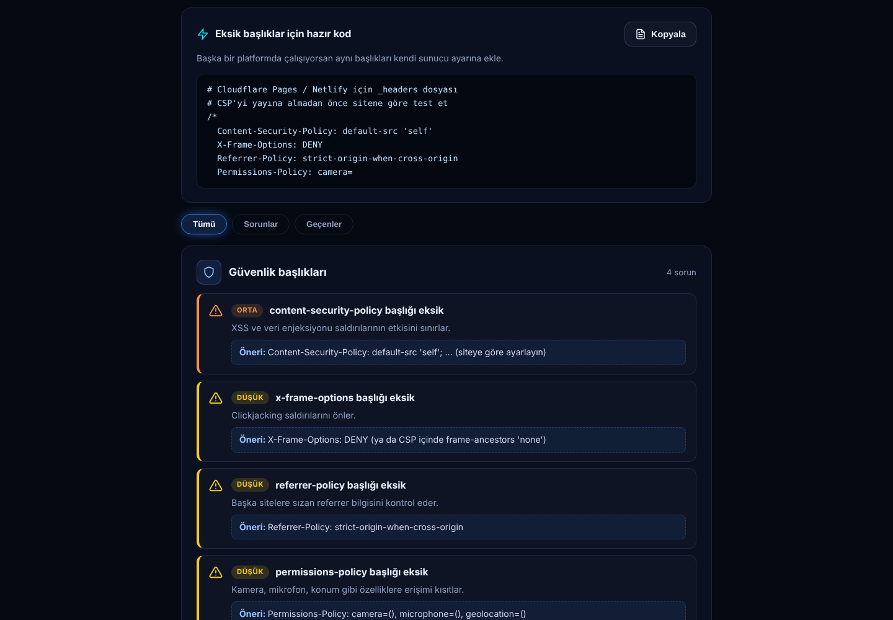
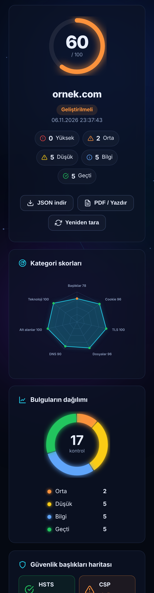

<div align="center">



**Alan adını gir, dışarıdan görünen güvenlik yüzeyini saniyeler içinde gör.**


</div>

AfemSpectra, Cloudflare Workers üzerinde çalışan, tamamen **pasif** bir web güvenlik kontrol aracıdır. Bir sitenin dışarıdan görünen "spektrumunu" tek raporda toplar: güvenlik başlıkları, cookie bayrakları, TLS, `security.txt`/`robots.txt`, DNS (SPF, DMARC, CAA), alt alan adları ve teknoloji izleri. Sonuç 0-100 arası bir skor ve görsel bir raporla sunulur.

> **Uyarı:** Yalnızca sahibi olduğunuz veya yazılı izin aldığınız alan adlarını tarayın.

<div align="center">

</div>

## Neler yapar

- **Güvenlik başlıkları:** HSTS, CSP, X-Frame-Options, X-Content-Type-Options, Referrer-Policy, Permissions-Policy ve cookie bayrakları
- **TLS ve HTTPS:** geçerli sertifika ve HTTP → HTTPS yönlendirmesi
- **DNS ve e-posta:** SPF, DMARC, CAA kayıtları
- **Alt alan adları:** sertifika şeffaflık kayıtlarından (crt.sh)
- **Standart dosyalar:** `security.txt`, `robots.txt`
- **Teknoloji izleri:** sunucu, CDN, framework ve sürüm sızıntıları

### Saldırı yüzeyi haritası

Alan adının etrafındaki altı nokta etkileşimli: her birinde ne kontrol edildiği ve saldırganın neden baktığı anlatılır.

<div align="center">

</div>

### Üç adımda rapor

<div align="center">

</div>

## Görsel rapor

Rapor; skor halkası, kategori bazlı radar grafik, önem dağılımı, güvenlik başlıkları haritası, bulunan alt alan adları ve teknolojileri gösterir. JSON indirme ve PDF / yazdır çıktısı vardır.

<div align="center">

</div>

Eksik başlıklar için kopyalanabilir hazır `_headers` kodu ve önem sırasına göre dizilmiş bulgular da raporun içinde:

<div align="center">

</div>

Mobilde de aynı rapor, tek sütunda:

<div align="center">

</div>

> Görseller örnek verilerle (`ornek.com`) hazırlanmıştır.

## Yapılmayanlar (bilinçli)

Port tarama, brute force, zafiyet sömürme ve benzeri aktif testler yoktur. Araç yalnızca herkese açık bilgileri okur. Pasif tarama tam bir güvenlik testinin (sızma testi) yerini tutmaz.

## Kurulum

```bash
npm install
npm run dev      # yerel geliştirme (http://localhost:8787)
npm run deploy   # Cloudflare'e yayınla (wrangler login gerekir)
```

## Proje yapısı

```
afemspectra/
├─ src/
│  ├─ index.ts      # Worker: /api/scan, /api/health, rate limit, güvenlik başlıkları
│  ├─ checks.ts     # pasif kontroller (başlıklar, dosyalar, DNS, alt alanlar)
│  ├─ guard.ts      # alan adı doğrulama, SSRF koruması, DNS-over-HTTPS
│  └─ types.ts
├─ public/          # arayüz (index.html, style.css, app.js, favicon.svg)
├─ scripts/         # ratelimit-test.mjs
├─ docs/            # banner, ekran görüntüleri, security.txt örneği
└─ wrangler.toml
```

## Uç noktalar

```
GET /api/scan?domain=ornek.com   # tarama
GET /api/health                  # durum ve rate limit türü
```

Tarama yanıtı: `{ domain, score, summary, findings[], subdomains[], technologies[], notes[] }`

`notes` alanı, sonuçların eksik olabileceği durumları (site botları engelliyor, crt.sh yanıt vermedi vb.) açıklar.

## Skor nasıl hesaplanır

100 puandan başlanır. Yüksek riskli her bulgu 25, orta riskli 10, düşük riskli 4 puan düşürür. Bilgi ve geçen kontroller puanı etkilemez.

## Güvenlik önlemleri

- Alan adı doğrulama (regex, IP ve iç ağ uzantıları reddedilir)
- SSRF koruması: alan adı DoH ile çözülür, özel/loopback IP'ye işaret ediyorsa reddedilir
- IP başına rate limit (Cloudflare bağlantısı yoksa yerel yedek)
- Yanıt gövdeleri boyut sınırıyla okunur (CPU ve bellek koruması)
- Site taramayı engelliyorsa yanlış "eksik" bulgusu üretilmez
- Arayüzde tüm uzak içerik `textContent` ile yazılır (XSS yok)
- Statik sayfalarda CSP, HSTS, X-Frame-Options vb. başlıklar
- Her dış istek için zaman aşımı

## Yayına almadan önce kontrol listesi

1. **Rate limit çalışıyor mu?** `wrangler.toml` içindeki limit `unsafe` bir tanımdır. Yayından sonra:
   ```bash
   node scripts/ratelimit-test.mjs https://SENIN-ADRESIN.workers.dev
   ```
   İlk 5 istek `200`, sonrakiler `429` dönmeli. `/api/health` yanıtında `rateLimiter` alanı `cloudflare-binding` ise Cloudflare limiti aktiftir, `yerel-yedek` ise yalnızca Worker örneği başına çalışan yedek limit kullanılıyordur. İkinci durumda Cloudflare panelinden bir rate limiting kuralı ekleyin.
2. **Ücretsiz plan CPU sınırı.** Workers ücretsiz planında istek başına CPU süresi kısıtlıdır. Yanıt okuma boyutları sınırlandırıldı, yine de yayından sonra panelde hata oranına bakın.
3. **İsim ve marka.** "Spectra" yaygın bir kelimedir. Büyütmeyi düşünüyorsanız alan adı, GitHub ve sosyal medya adını kontrol edin.
4. **Kendi sitenizi tarayın.** Yayınladığınız adresi aracın kendisiyle tarayıp başlıkların geldiğini doğrulayın.
5. **`security.txt` ekleyin.** `docs/security.txt.example` dosyasını kendi bilgilerinizle doldurup sitenizde `/.well-known/security.txt` olarak yayınlayın.

## Yol haritası

- Cookie/başlık kontrollerini ek sayfalarda da çalıştırma
- TLS protokol/şifre seti bilgisi (harici API ile)
- React/TypeScript/Tailwind arayüzü

## Geliştirici

**Ferdi Birgül**  
*IT & Network Support Specialist | Offensive Security*

Ağ altyapısı, sistem yönetimi, teknik destek ve siber güvenlik üzerine çalışan bir bilişim profesyoneliyim. **AfemSpectra** projesini, web güvenliğiyle ilgili temel kontrolleri herkesin anlayabileceği görsel bir raporda birleştirmek ve güvenliğe yönelik farkındalığı artırmak amacıyla geliştirdim.

Bu proje, güvenlik bilgilerini yalnızca toplamakla kalmayıp **anlaşılır, izlenebilir ve geliştirilebilir** hale getirme yaklaşımımın bir parçasıdır.

- 🌐 **Web sitesi / Portföy:** [ferdibirgul.com](https://ferdibirgul.com/)
- GitHub: [@Ferdibrgll](https://github.com/Ferdibrgll)
- LinkedIn: [linkedin.com/in/ferdibirgül](https://www.linkedin.com/in/ferdibirg%C3%BCl)

Geri bildirim ve katkılar için issue açabilirsiniz.

## Lisans

MIT, bkz. [`LICENSE`](LICENSE).
